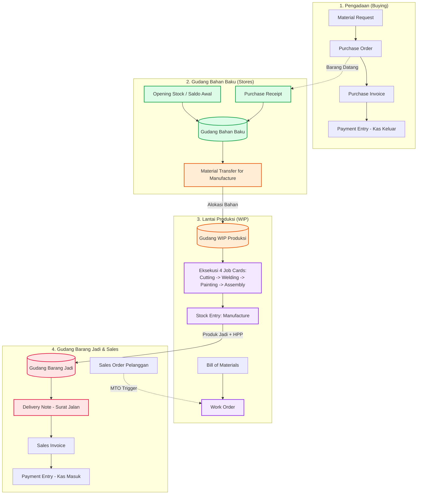

# FLOWCHART & STANDAR OPERASIONAL SISTEM PERSEDIAAN ERPNEXT
**Perusahaan Simulasi:** PT Rio Ferdinanda Manufaktur  
**Sistem:** ERPNext (Modul Stock, Manufacturing, Buying, Selling, & Accounting)  
**Dokumen Terkait:** `Flowchart_Sistem_Persediaan_ERPNext.docx`

---

## 1. Gambaran Umum Kebijakan Persediaan
Sistem persediaan di PT Rio Ferdinanda Manufaktur menerapkan metode **Perpetual Inventory System** dengan valuasi **Moving Average / FIFO**. 
Persediaan diklasifikasikan ke dalam 3 zona gudang operasional:
1. **Gudang Bahan Baku - RF - RFM:** Zona penyimpanan material mentah (*Raw Materials & Consumables*).
2. **Gudang WIP Produksi - RF - RFM:** Zona perakitan lantai pabrik (*Work-in-Progress*).
3. **Gudang Barang Jadi - RF - RFM:** Zona produk akhir yang telah lolos QC dan siap dikirim (*Finished Goods*).

---

## 2. Diagram Alir Persediaan (Visual Flowchart)
Diagram visual beresolusi tinggi tersedia dan telah di-embed ke dalam dokumen Word:
- Berkas Gambar: `flowchart_persediaan_erpnext.png`
- Berkas Word: `Flowchart_Sistem_Persediaan_ERPNext.docx`

---

## 3. Matriks Dokumen & Aturan Mutasi Persediaan di ERPNext

| Dokumen ERPNext | Tipe Transaksi | Gudang Asal | Gudang Tujuan | Efek Stok Fisik | Dampak Jurnal Finansial (GL Entry) |
|---|---|---|---|---|---|
| **Stock Entry (Material Receipt)** | Saldo Awal (Inbound) | - | Gudang Bahan Baku | Bertambah (+) | Debit Persediaan Bahan, Kredit Akun Penyeimbang Saldo Awal |
| **Purchase Receipt** | Penerimaan PO (Inbound) | - | Gudang Bahan Baku | Bertambah (+) | Debit Persediaan Bahan, Kredit Stock Received But Not Billed |
| **Stock Entry (Material Transfer)** | Alokasi Pabrik (Transfer) | Gudang Bahan Baku | Gudang WIP Produksi | Netral (±0) | Debit Persediaan WIP, Kredit Persediaan Bahan Baku |
| **Stock Entry (Manufacture)** | Selesai Produksi | Gudang WIP Produksi | Gudang Barang Jadi | WIP (-) Produk Jadi (+) | Debit Persediaan Barang Jadi, Kredit Persediaan WIP + Beban Operasi |
| **Delivery Note** | Pengiriman (Outbound) | Gudang Barang Jadi | - | Berkurang (-) | Debit Beban Pokok Penjualan (COGS), Kredit Persediaan Barang Jadi |
| **Stock Reconciliation** | Stock Opname (Audit) | Bebas / Tiap Gudang | - | Penyesuaian Fisik | Debit/Kredit Akun Selisih Persediaan (Stock Adjustment) |

---

## 4. SOP Pengendalian Stok
1. **Prinsip No Transfer, No Manufacture:** Pembuatan barang jadi pada *Stock Entry (Manufacture)* hanya dapat disubmit jika bahan mentah telah tercatat berada di `Gudang WIP Produksi`.
2. **Kalkulasi HPP Otomatis:** ERPNext secara otomatis mengakumulasi biaya bahan baku yang terkonsumsi ditambah tarif jam kerja stasiun kerja (Workstations) untuk menentukan harga pokok unit barang jadi.
3. **Pengurangan Stok di Surat Jalan:** Stok berkurang bukan saat Sales Order atau Invoice dibuat, melainkan saat **Delivery Note** disubmit.
